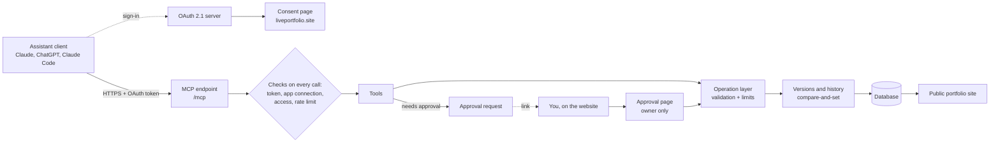

# LivePortfolio MCP

A production Model Context Protocol (MCP) server that lets AI agents (Claude, ChatGPT, Claude Code) read and edit a user's [LivePortfolio](https://liveportfolio.site) portfolio safely. It is a worked example of agent tool design with security built in: OAuth 2.1 with PKCE and per-user consent, assistant tokens accepted only at the MCP endpoint, versioned edits with compare-and-set and undo, and human-in-the-loop approval for risky changes, so an agent never gets unchecked control.

**Engineering highlights**
- Human-in-the-loop approval for removals, whole-list replacements, batches and new links (out of band: the agent cannot approve for itself)
- Versioned, undoable edits with optimistic concurrency
- Prompt-injection stance: user content is data, never instructions
- 56 tools covering every editable field, each tested end to end, and a documented threat model

[Architecture](docs/architecture.md) · [Security model](docs/security.md) · [Tool reference](docs/tools.md) · [Design decisions](docs/design-decisions.md)

This repository holds the documentation and the registry listing (`server.json`) for the hosted server. The application itself is not open source.

- Server address: `https://liveportfolio.site/mcp` (Streamable HTTP, OAuth 2.1 with PKCE)
- Requires a LivePortfolio **Pro** account
- Docs: https://liveportfolio.site/docs/mcp · Connect guides: https://liveportfolio.site/connect · Agent index: https://liveportfolio.site/llms.txt

<!-- DEMO VIDEO: 30 to 45 seconds. Link or embed it here once it is posted. -->

## How it works



## Documentation

- [Architecture](docs/architecture.md): system overview and sequence diagrams for sign-in, a direct edit and an approval-gated edit
- [Security](docs/security.md): what an assistant can and cannot do, controls, prompt injection, pictures, known limits
- [Tools](docs/tools.md): all 56 tools grouped by section, with limits and what the public page shows
- [Design decisions](docs/design-decisions.md): trade-offs, and the known gap after approval
- [Changelog](CHANGELOG.md)

## Assistants

Tested: Claude (web and desktop), ChatGPT and Claude Code. Gemini CLI, Cursor and VS Code may work (any client that speaks MCP over HTTP with OAuth) but may need manual setup.

## Connect

1. Add `https://liveportfolio.site/mcp` as a custom connector. Steps with screenshots: [Claude](https://liveportfolio.site/docs/connect/claude), [ChatGPT](https://liveportfolio.site/docs/connect/chatgpt), [others](https://liveportfolio.site/docs/connect/other).
2. Sign in, choose what the assistant may do, and approve. Then start a new chat with the first message shown on the connect page.

Claude Code:

```bash
claude mcp add --transport http liveportfolio https://liveportfolio.site/mcp
```

## What it can do (56 tools)

- **Read:** the portfolio (by section), the editing rules, designs, a completeness checklist, history, a preview of a change, a health check.
- **Profile and contact:** name, role, headline, About, location, email, phone, WhatsApp, social links; add to a field or replace one phrase.
- **Skills:** flat list and groups (add, remove, rename, reorder, replace).
- **Experience and projects:** roles and highlight lines; projects with stack, links, pictures and an optional Power BI dashboard.
- **Education, certifications, testimonials:** add, fix one, remove one, reorder, replace.
- **Photos and design:** upload link or a public https picture; template, look, Pro design version.
- **Safety net:** undo, restore an earlier version, and one batch of up to 60 operations for a whole-CV update.

## Security model

- OAuth 2.1 with PKCE. Assistant tokens work only on `/mcp`; browser tokens do not work there, and assistant tokens are refused on every other API route.
- Access is per person and checked on every call. Disconnect at https://liveportfolio.site/oauth/connections and the next call fails.
- Direct edits are undoable. Removals, whole-list replacements, batches, new links and large cuts need your approval on liveportfolio.site; the assistant cannot approve for itself.
- Your email, phone and WhatsApp are hidden from the assistant unless you allow them. You can connect read-only.
- We do not store your chat messages. See the [privacy policy](https://liveportfolio.site/privacy).

## Limits

60 operations per batch, 30 flat skills, 1500 characters per project text field, 120 calls per 10 minutes, 60 edits per hour. The public page shows the first 5 stack items, the first testimonial and, when you have skill groups, the groups rather than the flat list; the assistant is warned when something is saved but not shown.

## It cannot

Publish your portfolio, change your address or domain, touch billing, change your sign-in, delete anything, or create your first portfolio.

## Contact

nwannachumaclifford@gmail.com
