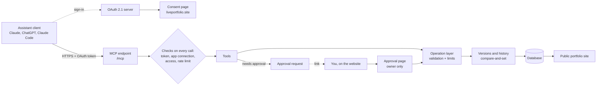
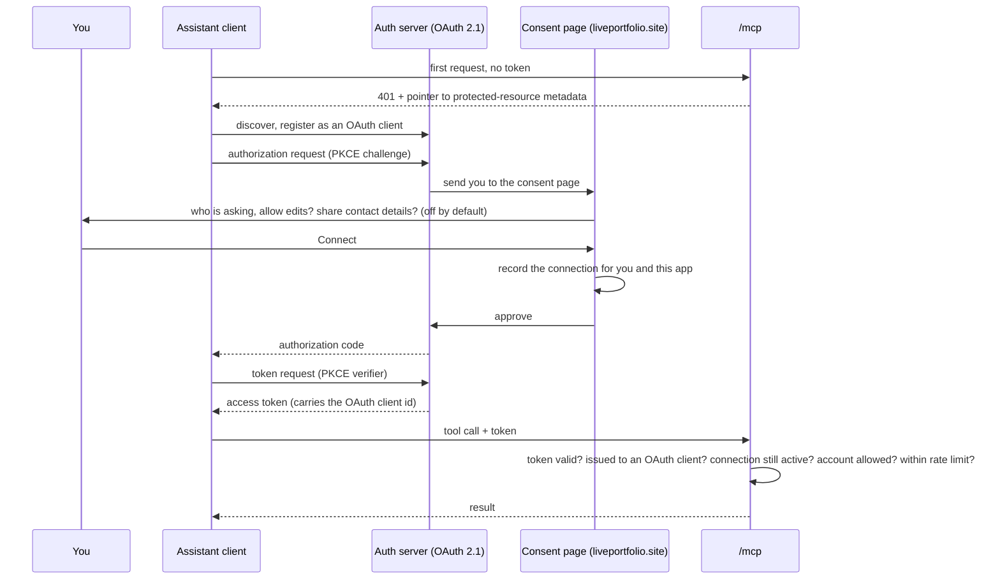
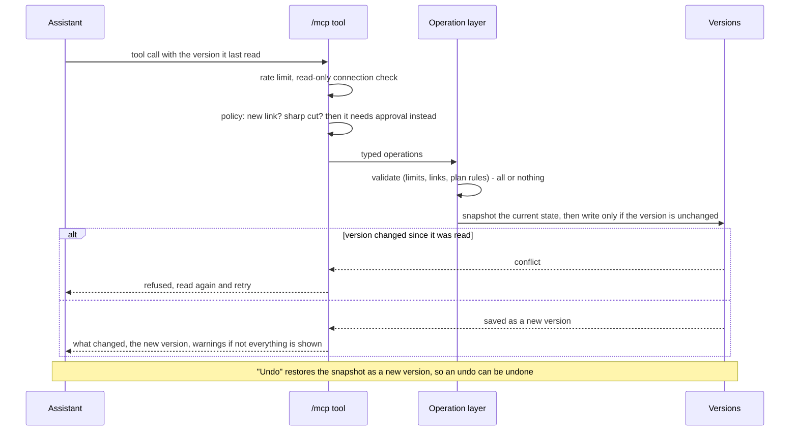
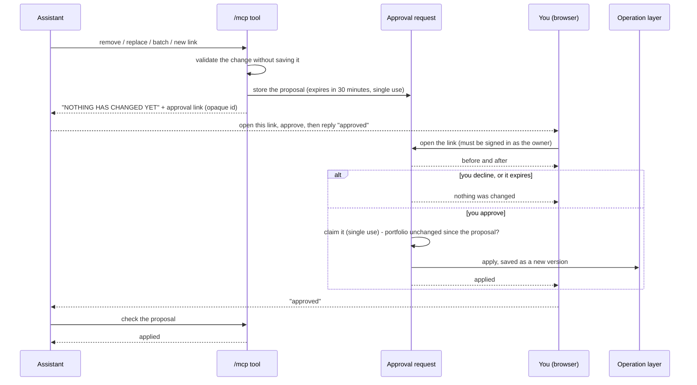

# Architecture

How the LivePortfolio assistant connection works. This describes what the server does today; where something is not verified, it says so. The application source is not public.

## System overview

Key points:

- Assistant tokens are accepted only at `/mcp`. Browser sign-in tokens are rejected there, and assistant tokens are rejected on every other API route of the site.
- Every change, from the dashboard or an assistant, goes through the same operation layer. There is no second way to write portfolio content.
- Changes that could hurt (removals, whole-list replacements, batches, new links, sharp cuts) are not applied by the assistant. It receives a link; you approve on the website.

## OAuth 2.1 sign-in with PKCE, and token scoping

Token scoping:

- An access token issued to an assistant carries an OAuth client identifier; a browser sign-in token does not. `/mcp` accepts only the former. Every other API route refuses the former.
- Authorisation is not left to the token alone: each call also checks that you still have an active connection for that app. Revoking the connection stops the very next call, even while the token has not expired.
- The consent screen shows a "Verified" badge only when the return address is exactly `chatgpt.com` or `claude.ai` over https, and a warning for anything else.

## A direct edit (saved at once, undoable)

## An approval-gated edit

The assistant never holds the power to approve: the approval endpoint accepts browser sign-in tokens only, and assistant tokens are refused there.

## What is verified

Covered by automated tests that run against an in-memory database with throwaway users: token separation on every API route, per-call connection checks and revocation, access by plan, rate limits, isolation between users, version conflicts and concurrent edits, undo, the approval flow (before approval nothing changes, expiry, single use, owner-only), field limits, link validation, and hostile text stored as plain data.

Not verified by automation: the real OAuth sign-in with each vendor's client, how each assistant chooses tools, and how the approval page looks in each browser. These are checked by hand.
